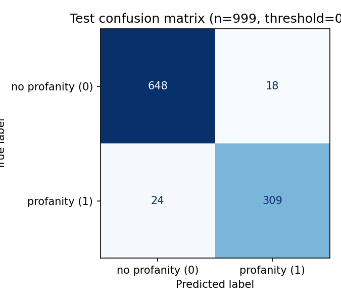

# Kazakh Profanity Detection

Binary classifier that reads one Kazakh product/app review (or any short comment) and predicts whether it contains **Kazakh profanity**: `0` = no profanity, `1` = profanity present. A fine-tuned **XLM-RoBERTa-base** outputs a label and the probability of the profanity class.

**Author:** Karlygash Ussen · KBTU, Algorithms of Computer Vision, bonus project (individual work)

| | |
|---|---|
| Trained model | https://huggingface.co/karlygaw/kazakh-profanity-xlmr |
| Live demo (Gradio Space) | https://huggingface.co/spaces/karlygaw/KazProSpace |
| Dataset source | [`issai/kazsandra`](https://huggingface.co/datasets/issai/kazsandra) (gated, CC BY 4.0) |

Notebooks :
[01 data preparation](https://colab.research.google.com/github/karlygaw/kazakh-profanity-detection/blob/main/01_data_preparation.ipynb) ·
[02 training and evaluation](https://colab.research.google.com/github/karlygaw/kazakh-profanity-detection/blob/main/02_train_evaluate.ipynb) ·
[03 inference](https://colab.research.google.com/github/karlygaw/kazakh-profanity-detection/blob/main/03_inference.ipynb)

## Results at a glance

Held-out test set, n = 999 (333 with profanity), decision threshold 0.70, metrics for the profanity class:

| Precision | Recall | F1 |
|---|---|---|
| 0.945 | 0.928 | 0.936 |

Confusion matrix (rows = true, columns = predicted): TN 648, FP 18, FN 24, TP 309. See [`results/`](results/).

**Read these numbers with the caveats in [Limitations](#limitations):** the labels come from a lexicon (so they are noisy and partly circular), the dataset is enriched with profanity, and almost all positives are app reviews.

## Repository structure

```
01_data_preparation.ipynb   build the dataset and the train/val/test splits
02_train_evaluate.ipynb     fine-tune, choose the threshold, evaluate once on the test set
03_inference.ipynb          load the saved model and classify new comments (no training, no data)
data/split_ids.csv          id, split and labels of every example (no review text)
results/                    test_metrics.json, confusion_matrix.png, test_predictions.csv
requirements.txt
```

## 1. Data

### Source and relation to product reviews

**KazSAnDRA** (*Kazakh Sentiment Analysis Dataset of Reviews and Attitudes*, ISSAI, Nazarbayev University, [arXiv:2403.19335](https://arxiv.org/abs/2403.19335), CC BY 4.0): 180,064 Kazakh reviews with 1-5 star ratings from four domains: `appstore` (135,073), `market` (30,289, product reviews), `mapping` (8,897) and `bookstore` (5,805). Access: accept the terms on the dataset page, then `load_dataset("issai/kazsandra", "full")` (a Hugging Face read token is required; notebook 01 reads it from the Colab secret `HF_TOKEN`).

The task is about reviews of goods, but profanity is very rare in product reviews (the lexicon found only a handful of hits in `market`). It is common in **app-store reviews**, which are reviews of digital products. The positive class therefore comes almost entirely from `appstore` (about 99% of the lexicon hits), and negatives are drawn from all four domains (mostly `appstore`, so that the model cannot learn "app review = profanity").

### The dataset's own labels do not fit this task

The only labels in KazSAnDRA are star ratings, i.e. sentiment. A 5-star review can contain an obscenity ("great, damn good") and a 1-star review usually does not. In our data, 934 of 2,239 profane examples have 5 stars and 1,142 have 1 star. The profanity label (`is_profane`) is therefore created from scratch; the rating is kept only as a side column named `rating`.

### Labeling rules

**Label 1 (profanity present):** the comment contains an obscene or vulgar word or expression:
- Kazakh vulgar words and expressions;
- Russian obscenities (*mat*) used inside Kazakh text. Mixed-language comments are positive if either language contributes the profanity, because real users code-switch. Completely Russian comments are not the target of this project;
- disguised forms the author (a native speaker) recognises as the same word: stretched letters, Latin look-alike letters, typical misspellings and short forms that replace the full expression.

**Label 0:** everything else. In particular a **negative review is not profane**: complaints, anger and rudeness without obscene words are 0. Hard negatives that look suspicious but are clean are kept on purpose: religious blessings (*әмин*), words about sorcery, names, inflected ordinary words that resemble a profane root, sizes such as `45*45`, decoration such as `***` and emoji.

**Masked words:** a masked word counts only if it can be recognised (for example when most letters are visible). Texts whose profane word cannot be reconstructed (`Ш**********`, symbols only) and texts whose only signal is an offensive-gesture emoji are treated as ambiguous and excluded.

**Ambiguous cases excluded from the dataset:** the masked texts above and texts with mild non-obscene insults (for example *мал*, *ешек*, *айуан*). Under this narrow definition they are neither clearly profane nor clearly clean.

**Synthetic examples:** none. Every example is a real review (`is_synthetic = 0`).

### Examples (all real reviews from KazSAnDRA)

| Text | Label | Why |
|---|---|---|
| Зарядка жоқ | 0 | 1-star complaint, no profanity |
| Сапасы жаман, алғаныма өкініп қалдым! | 0 | angry but not obscene |
| Қуанып қалдым. Заттар ойымдағыдай, керемет. | 0 | 5-star product review |
| Жұмсақ мата, өлшемі 45*45. түсі қызыл. | 0 | hard negative: `*` is part of a size |
| Пиздец күшті | 1 | praise (5 stars) that contains an obscenity |
| Блят ақшамды алып алды и интернет імді жоқ кылды | 1 | Kazakh-Russian code-switching |
| Ш********** тартылмаиды | excluded | masked word cannot be recovered |
| Мал ешекбас өтырык тарпаңдар | excluded | mild insults without obscenity |

### How the labels were created

Reading 180k reviews is not feasible and random sampling would contain almost no profanity, so candidates for the positive class were found with a **lexicon of profane roots** (notebook 01). Text is normalised for matching (lower-casing, Latin look-alike letters mapped to Cyrillic, Kazakh letters folded to base letters, masking symbols removed, repeated letters collapsed). Short forms are matched only as whole words, and some roots are matched on the raw letters to avoid collisions (for example a blessing or a sorcery word collapsing onto a profane root). The lexicon was compiled by the author with AI assistance and refined against the data: every root was checked on samples of its matches and restricted or removed when it matched clean words.

Quality checks:
- **Precision audit:** 60 randomly selected lexicon hits were read in full: 60/60 contained profanity. The audit was done on an earlier version of the lexicon; roots added later were checked on samples of their own matches.
- **Recall check:** about 160 random lexicon-free negative app reviews were read in two rounds. A few missed words were found and added (a short disguised form, a compounded insult, one more vulgar word); the rest was clean. This is a small sample, so the recall of the lexicon on the full data is unknown.

The lexicon is used only to build the dataset. The classifier is trained on text, not on the lexicon.

### Dataset statistics and splits

6,728 examples after removing exact duplicates: **2,239 with profanity (33%) and 4,489 without**. Negatives: random app reviews, 1-star app reviews, reviews from the other three domains, and hard negatives.

Splits: 70/15/15, **random seed 42**, done separately per class. Exact duplicates are removed, and near-duplicates (equal after lower-casing and removing punctuation and repeated letters) are grouped so that a group never crosses a split boundary.

| Split | No profanity (0) | Profanity (1) | Total |
|---|---|---|---|
| train | 3,140 | 1,574 | 4,714 |
| val | 683 | 332 | 1,015 |
| test | 666 | 333 | 999 |
| total | 4,489 | 2,239 | 6,728 |

| Split | appstore | market | bookstore | mapping |
|---|---|---|---|---|
| train | 3,786 | 447 | 286 | 195 |
| val | 803 | 84 | 85 | 43 |
| test | 791 | 111 | 51 | 46 |

Profanity type of the positives, derived from the matched roots: Kazakh only / Russian only / both.

| Split | Kazakh | Russian | Mixed |
|---|---|---|---|
| train | 844 | 535 | 195 |
| val | 176 | 119 | 37 |
| test | 164 | 127 | 42 |

**Preprocessing:** phone numbers, links, e-mails and @-handles are replaced with `<PHONE>`, `<URL>`, `<EMAIL>`, `<USER>`. No reviewer names or contact details are kept. Nothing learned from the data (vocabulary, statistics) is used before the split, so no information leaks from validation or test.

**Data access:** the review texts are not redistributed (the dataset is gated). `data/split_ids.csv` lists every example (`custom_id`, split, labels, domain, rating) without text. Anyone with access to KazSAnDRA can rebuild identical splits by running notebook 01.

## 2. Model

**XLM-RoBERTa-base** (`FacebookAI/xlm-roberta-base`, Conneau et al., [arXiv:1911.02116](https://arxiv.org/abs/1911.02116)) fine-tuned with a 2-class classification head.

Why: a multilingual pretrained encoder that covers Kazakh and Russian, which matters because the comments mix both. Its SentencePiece tokenizer splits misspelled, masked, transliterated or unknown words into known subwords, so there are no out-of-vocabulary tokens. With a few thousand examples, fine-tuning a pretrained model works much better than training from scratch.

**From text to model input:** masking of personal data, then tokenization into subwords, truncation to **128 tokens** (reviews are short: the median is about 46 characters in the product domains, so truncation is rare), padding per batch. Punctuation, emoji and case are left to the tokenizer.

**Training settings** (all in notebook 02): AdamW, learning rate 2e-5, weight decay 0.01, linear schedule with 10% warm-up, batch size 32, 3 epochs, gradient clipping 1.0, cross-entropy loss, **seed 42**, one T4 GPU in Google Colab (a few minutes). After every epoch the model is scored on the validation set (threshold 0.5) and the best epoch by validation F1 is saved.

| Epoch | Train loss | Val precision | Val recall | Val F1 |
|---|---|---|---|---|
| 1 | 0.494 | 0.842 | 0.801 | 0.821 |
| 2 | 0.279 | 0.892 | 0.922 | 0.907 |
| 3 | 0.167 | 0.919 | 0.928 | 0.924 |

**Decision threshold: 0.70**, chosen on the validation set. Validation F1 is flat (0.904-0.926) for thresholds between 0.10 and 0.90, so F1 alone does not decide. Real review streams contain far less profanity than this dataset, and at such imbalance false positives quickly dominate the flagged comments, so a higher threshold was chosen to favour precision at a small cost in F1 (validation at 0.70: precision 0.937, recall 0.898, F1 0.917; the F1 maximum was 0.926 at 0.40). The threshold was fixed before the test set was evaluated and was not changed afterwards.

**Saved files** (Hugging Face Hub): weights, tokenizer files and `inference_config.json` (threshold, maximum length, base model, seed).

## 3. Evaluation

The test set was used only after the model and the threshold were fixed.

| Metric (profanity class) | Value | 95% Wilson interval |
|---|---|---|
| Precision | 0.945 (309 / 327) | 0.915 - 0.965 |
| Recall | 0.928 (309 / 333) | 0.895 - 0.951 |
| F1 | 0.936 | |
| Accuracy | 0.958 | |

| | Predicted 0 | Predicted 1 |
|---|---|---|
| **True 0** | 648 | 18 |
| **True 1** | 24 | 309 |



Number of test examples: **999**. Recall by profanity type: Kazakh 0.933, Russian 0.898, mixed 1.000 (Russian-only recall is lower, but with 127 examples the difference is within noise).

**Two training runs.** The model was trained twice (the second time to check reproducibility). The first run reached test precision 0.925, recall 0.928, F1 0.927 (confusion matrix 641/25/24/309); the second one, **published on the Hub and reported above**, reached 0.945 / 0.928 / 0.936. The gap comes from non-deterministic GPU operations, and the two results should be read as the same quality with about one point of F1 of run-to-run noise. The threshold was selected on the validation set of the first run and was not changed after seeing any test result.

**What the errors mean.**
- A **false positive** is a clean comment flagged as profane: a real customer's review is blocked or sent to a moderator for nothing.
- A **false negative** is a profane comment that gets through.

Which one matters more depends on the policy. If flagged comments only go to a human moderation queue, false negatives are costlier. If flagged comments are removed automatically, false positives are costlier and the threshold should be higher. The same model can serve both with different thresholds (validation F1 changes little between 0.4 and 0.9, while precision rises and recall falls).

## 4. Error analysis

Examples are from the **validation** set of the published model (the test set was kept for the final evaluation). Probabilities are for the profanity class; the threshold is 0.70.

| Text (shortened) | Label | Prob. | What happened | Practical improvement |
|---|---|---|---|---|
| Маған ұнайды бляя😎😎 | 1 | 0.006 | **Missed.** Stretched letters, plus a positive sentence and smiley emoji: the model follows the sentiment. | Collapse repeated letters before tokenization (as the lexicon already does) and augment with stretched variants. |
| Сыныптастан келдым нехуя екен приложения | 1 | 0.030 | **Missed.** An obscenity with a prefix, rare in the training data. | More examples of rare forms, or an ensemble with a character n-gram model. |
| Мынау оиын өте өте өте көтек оиын | 1 | 0.033 | **Missed.** A rarely seen word (added to the lexicon late, so few training examples). | Add more examples of the rare roots. |
| Қызық емес қо да / Каиф оин ғой каиф | 0 | 0.94 / 0.95 | **False alarm.** No profane word; chatty particles (*қо*, *ғой*) and informal spelling are frequent in the profane training comments, so the model partly learned the **style**. | Add more clean, informal comments as negatives (hard-negative mining) and compare with a lexicon-only baseline to measure the shortcut. |
| Мте керемет енды маған біреу боқтаса амн шғарамн | 0 | 0.987 | **Label error, model probably right.** Contains a shortened disguised form that the lexicon did not know. | Review confident false positives by hand and add the missing forms (error-driven label cleaning). |
| Жаман 👎үясыздардіңкі ти то к | 0 | 0.944 | **Boundary case.** A mild insult (*үясыз*, "shameless"); by the labeling rules insults without obscenity are 0. | Make the insult boundary explicit (a third class or excluded texts) and apply it consistently. |
| Жыберген отклиниктер ошпид архивте калады ... | 0 | 0.990 | **Unexplained** false alarm: no profane word is visible; heavy informal spelling is the only suspect. | More data and token-level inspection; I could not find the reason. |
| ШЕШЕН СЫГИЫНДЕР ! ЖАНА ЖУМЫСТАН КЕЛIП ... НАМАЗ ОКЫП ... (long, ALL CAPS) | 1 | 0.021 | **Missed.** A heavily distorted Kazakh curse in capital letters at the start of a long complaint full of ordinary religious vocabulary. Possible reasons (hypotheses): capitalised, misspelled text is split into rare subword pieces, and the long clean context outweighs the short disguised word. | Augment with upper-case and distorted variants, and lower-case the text before tokenization. (Example chosen by the author.) |
| Менде алоэ сығындысының тонері ... / Рахмат коттакон 1 кунда етиб келди / Сіге де ұнары сөзсіз | 1 | 0.008 / 0.010 / 0.009 | **Label errors, model right.** The lexicon matched clean words after normalisation: *сығынды* ("extract") collapses onto a profane root, *коттакон* matches another root, and *Сіге* (typo of "сізге") matches a short raw prefix. | Tighten the roots, then re-label and retrain. |

Among the 10 most confident misses on the validation set, 3 are lexicon false matches (label noise, not model errors) and one more (*Ам сияқты ұнады*, where "ам" can be a name or abbreviation) is ambiguous; the other 6 are real model misses. The true recall is therefore somewhat higher than the measured one. This is also the main weakness of the whole approach: **evaluation is against labels produced by the same kind of lexicon used to build the data.**

## Limitations

- **Lexicon-based labels are noisy and partly circular.** Positives are what the lexicon finds, so the model may learn the listed words, and profanity not in the lexicon is labeled 0 (about 160 negatives were checked by hand, which is small). Precision of the labels was audited on 60 examples (60/60), recall was not measured on the full data.
- **Dataset enriched with profanity.** About one third of the examples are positive; profanity is much rarer in real reviews (the lexicon matched about 1.3% of all KazSAnDRA reviews, a lower bound). As a rough illustration, with the measured recall (0.928) and false positive rate (18/666 = 2.7%), the precision on a stream with 1.3-1.6% profanity would be about 31-36% (about 64% at 5%). The false positive rate on a real stream may be lower, because our negatives contain many hard cases, but expect many more false alarms than the test precision suggests. This is why the threshold was set high.
- **Domain bias.** About 99% of the positives are app reviews; the model is barely tested on reviews of physical goods, where profanity is almost absent.
- **A few frequent roots dominate** the positive class (one Kazakh root alone appears in about half of the hits), so the model may rely on those words; recall on rare words, Latin spellings and stretched letters is weaker.
- **Informal style is partly learned as a signal** (see the error analysis).
- **Narrow definition:** mild insults are excluded from the data, so the model's behaviour on them is undefined.
- **Small test set:** 333 positives give a 95% interval of about plus or minus 3 points. One seed and two training runs; run-to-run noise is about one point of F1.
- **Not a moderation system:** it should support a human reviewer, not replace one.

## Reproducing the results

1. Accept the terms of [`issai/kazsandra`](https://huggingface.co/datasets/issai/kazsandra), create a Hugging Face **read** token and store it in Colab Secrets (`Secrets` panel) as `HF_TOKEN` with notebook access on.
2. Open **`01_data_preparation.ipynb`** in Colab and run all cells (CPU is enough). It writes `train.csv`, `val.csv`, `test.csv` and `split_ids.csv` to the `kazakh_profanity_data` folder on Google Drive, and ends with a check that the split sizes equal 4,714 / 1,015 / 999.
3. Open **`02_train_evaluate.ipynb`**, select a **T4 GPU** (`Runtime > Change runtime type`) and run all cells. Set `RETRAIN = False` to skip training and reuse a saved model. The model, `inference_config.json` and the results are saved to Google Drive.
4. Python 3.13, package versions: see `requirements.txt`. The last cell of each notebook prints the exact versions in use. GPU training is not bit-exact, so a rerun gives slightly different numbers.

## Using the trained model without retraining

**Notebook:** open `03_inference.ipynb`, set `MODEL_ID = "karlygaw/kazakh-profanity-xlmr"` and run the cells; the last cell lets you type your own comments.

**Python:**

```python
import json
import torch
from huggingface_hub import hf_hub_download
from transformers import AutoModelForSequenceClassification, AutoTokenizer

MODEL_ID = "karlygaw/kazakh-profanity-xlmr"
tokenizer = AutoTokenizer.from_pretrained(MODEL_ID)
model = AutoModelForSequenceClassification.from_pretrained(MODEL_ID).eval()
config = json.load(open(hf_hub_download(MODEL_ID, "inference_config.json")))

def predict(text):
    enc = tokenizer(text, truncation=True, max_length=config["max_len"], return_tensors="pt")
    with torch.no_grad():
        prob = torch.softmax(model(**enc).logits, -1)[0, 1].item()
    return {"label": int(prob >= config["threshold"]), "probability": round(prob, 3)}

print(predict("Өте жақсы қосымша, маған ұнады"))
```

**Web demo:** https://huggingface.co/spaces/karlygaw/KazProSpace (Gradio on a free ZeroGPU Space, the first request after a pause can take about a minute).


## AI assistance and my contribution

I used ChatGPT, Gemini, Claude (Anthropic) as an assistant. My own contribution: choosing the data source and the domains, defining the labeling rules as a native speaker (what counts as profanity, how to treat Russian obscenities, masked words, short and stretched forms, mild insults), checking the lexicon roots and their false matches on the data, the manual audit of the labels and the reading of negative reviews, deciding what to include and exclude, running and checking all experiments, selecting the threshold, and analysing the errors.

## Acknowledgements and licenses

Data: KazSAnDRA by ISSAI (CC BY 4.0), please cite the paper above. Base model: XLM-RoBERTa (MIT). The fine-tuned model and the code in this repository are released for educational use.
